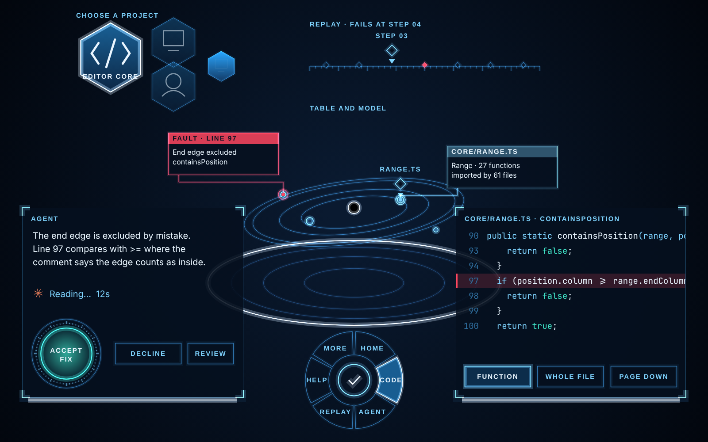

# Visual style: light on glass

This is how every panel, label, marker and surface in Orrery should look. It applies to
all tasks in both plans that draw something. Where a plan gives a colour or a look that
differs from this page, this page wins.

The reference sheet is `docs/style/hologram-reference.png`, and the code that drew it is
`docs/style/mock.html`. Its drawing functions (`glowStroke`, `glassPanel`, `slab`,
`microLabel`, `marker`, `leaderCard`, `hexTile`, `ringMenu`, `roundAction`, `stepTrack`,
`button`) are written to be copied into panel drawing code.

## Where the look comes from, and where it must stop

The owner's reference is the ship interfaces in the film *Passengers* (2016), made by
the team at MPC London. All 34 frames in the gallery listed under Sources were studied.
What we take from them is a **design language**, as patterns:

| Seen in the film | The pattern we use |
| --- | --- |
| A see-through model of the ship floating over a table, with people standing round it | Our whole scene: the galaxy floating over a table with ring guides |
| Small glass cards around that model, each tied to a spot on it by a thin line; blue for information, red for a fault | Leader cards: every info card is tied to its file or town by a leader line; the bug's card is red |
| Honeycomb tiles with line icons; the chosen one large and forward, the rest smaller and fading back | Hex tiles for choosing a project and for icon choices |
| A dark console with a segmented ring of commands round a centre that confirms | The ring menu on the palm and at the table's edge |
| One large round control for the step that matters | The round action for accepting a fix |
| A clear slab standing on a small lit base | Slabs: panels stand on a lit base bar instead of floating free |
| Thin white text with fine lines on glass, numbers in small badges | Micro labels and markers |
| Dark consoles drawn entirely in fine teal and blue lines | Glass panels: line work, no filled blocks |

What we do **not** take: any frame, screen layout, logo, icon, wording or asset from the
film. The competition requires original work and forbids commercial artwork, and a
design language is free to learn from while a specific screen is not. Concretely:

- Do not copy an image from the film or from a site about it into the repository.
- Do not reproduce a recognisable screen (the pod diagnostics, the ship's model, logo
  or name, the wording on its controls).
- There are no charts or graphs in this app. The owner's first reference frame showed
  one only to convey colour and type.
- Every shape here is drawn by our own code from the tokens below.

## The five rules

1. **Light, not paint.** Lines and shapes glow against darkness. Draw a line twice: a
   wide faint pass, then a thin bright one, with additive blending. No drop shadows, no
   gradients on buttons, no rounded cards.
2. **Glass you can read on.** Text always sits on a dark backing that is at least 85%
   opaque. Purely additive, see-through elements never carry text the user must read.
   The film's screens look wonderful and are often hard to read; ours must be read.
3. **Cool is information, red is a fault.** Blues and white for everything normal. Red
   only for the bug and for failures. Amber only for a label that needs attention. Teal
   green for success and for the action that fixes things. If a view has more than
   three warm things, it has too many.
4. **Thin and exact.** Lines are 1 to 2 pixels on a panel canvas. Corners are square.
   Panels are framed by a hairline and four corner brackets, not a border all round.
5. **Small capitals for names, sentences for sentences.** Labels, titles and buttons are
   uppercase with wide spacing. Anything longer than five words is ordinary sentence case
   in the body font.

## Tokens

Put these in `src/core/theme.ts` as constants (it is pure data, so it belongs in core)
and use them everywhere. Do not write a colour or a font anywhere else.

| Token | Value | Used for |
| --- | --- | --- |
| `ink` | `#06101f` at 88% opacity | The backing of every text panel |
| `grid` | `#1b3b5c` | Faint rules, the table's grid, dividers |
| `lineDim` | `#2f6f9f` | Resting outlines, line numbers, orbits and guides |
| `line` | `#7fd4ff` | Active outlines, labels, keywords in code |
| `glow` | `#2aa7ff` | The fill of a hovered or pressed button, selection bands |
| `white` | `#eaf6ff` | Body text, identifiers in code, the bright core of a line |
| `amber` | `#ffb21a` | Attention labels and their pointers |
| `alert` | `#ff4760` | The bug: its card, its line's band and edge, its dot on the model; failures |
| `ok` | `#3fe0c5` | Success, the round action, added lines in a diff, literals in code |
| `work` | `#d97757` | The rotating working glyph only |

| Font token | Value | Used for |
| --- | --- | --- |
| `label` | Barlow Condensed 600, uppercase, letter spacing 2 px at 15 px | Labels, titles, buttons |
| `body` | Barlow 400 | Sentences |
| `mono` | JetBrains Mono 400 | Code |

All three fonts have open licences and install from npm (`@fontsource/barlow-condensed`,
`@fontsource/barlow`, `@fontsource/jetbrains-mono`). Load them with `FontFace` before the
first panel is drawn. Sizes are set per panel in pixels of that panel's canvas and scale
with the `textScale` setting.

Diff colours follow the same rule: added lines on an `ok` band at 16%, removed lines on
an `alert` band at 16%, hunk headers in `lineDim`.

## Components

| Component | How it looks | Where it is used |
| --- | --- | --- |
| **Glass panel** | `ink` backing, hairline frame in `lineDim` at 60%, four glowing corner brackets in `line`, title as a micro label at the top left | The body of every panel |
| **Slab** | A glass panel standing on a dark base bar with one bright strip along it | Code page, chat, replay, settings: anything that stays in the room |
| **Leader card** | A small glass card with a coloured header bar, joined by a thin right-angled line to a dot with a halo on the thing it describes. `line` for information, `alert` for the fault | Info cards for a file or a town, the agent's "show me", the problem card |
| **Micro label** | The `label` font in `line`, `white` on a filled header, or `amber` for attention | Every title, every scene label, button text |
| **Marker** | A micro label, a diamond below it, and a small triangle pointing down at the thing | The selected file or town, the current replay step |
| **Hex tile** | A translucent hexagon with a bright edge and a white line icon. The chosen tile is larger with its name; others shrink and fade the further back they sit | Choosing a project; any choice among icons |
| **Ring menu** | Segments round a hub with a tick; the active segment fills with `glow`; names sit inside the segments | The palm menu, and the same ring at the table's front edge in place of a row of buttons |
| **Round action** | A large disc in `ok` inside a ring of fine ticks | Accepting a fix, and nothing else. Declining and reviewing stay ordinary buttons beside it |
| **Button** | Outline in `lineDim` at rest; on hover the outline brightens and the inside fills with `glow` at 20%; pressed fills to 42% | Every other button and chip. At least 4.5 cm tall in the room |
| **Step track** | A thin ruled line with one small diamond per step; the current step carries a marker; the step where the run fails is filled `alert` | The replay |
| **Band** | A full-width strip at 16–18% opacity with a 3 px solid edge on the left | Selected lines (`glow`), hovered lines (`glow` at 8%), the bug line (`alert`) |
| **The table** | A bright elliptical rim, faint ring guides inside it in `grid`, and the model floating a hand's width above | Under the galaxy |

On the model itself: orbits are thin `lineDim` lines, bodies have a bright rim, the
selected body has a marker, and the bug's location is a red dot with a halo joined to
its leader card.

Scene labels (file and function names above the model) use the micro label on a small
`ink` plate so they stay readable over stars.

## Motion

- **Things draw on.** A panel appears by its corner brackets extending, then its frame,
  then its contents, in about 250 ms. A leader line grows from the dot to its card.
- **The chosen thing comes forward.** A selected hex tile grows and moves toward the
  user while the others settle back and dim.
- **Things face you.** Panels and labels turn smoothly toward the head, never snapping.
- **One slow pulse.** The thing that needs attention breathes between 70% and 100%
  brightness once every 1.6 s. Nothing else pulses.
- **Reduce motion** (a setting) removes the draw-on, the pulse and the rotating glyph.

## In the room

Additive light looks right against darkness and washes out against brightness, so the
room stays dark: the star field, a dark floor, and one or two thin bright strips at the
table's rim as the only "lighting". On three.js materials use additive blending with
`depthWrite: false` and `toneMapped: false` for glowing lines, and keep panel textures
ordinary (not additive) so their backing stays dark. Do not add a bloom post-process: it
costs too much on a headset. The two-pass stroke is the glow.

**High contrast** (a setting) turns the backing fully opaque black, text pure white,
drops additive decoration, and thickens outlines to 3 px.

## How the plans apply this

| Plan and task | What changes |
| --- | --- |
| M1+M2 Task 6, labels | Micro label on an `ink` plate; the selected label becomes a marker |
| M1+M2 Task 10, canvas panels and info cards | `CanvasPanel` draws the glass panel. Info cards become leader cards: the line from card to anchor is a thin three.js line in the room, not part of the canvas. Add `src/core/theme.ts` and `src/panels/draw-kit.ts` with the functions from `mock.html` |
| M1+M2 Task 11, the room | The table as described above; a dark floor; one bright rim |
| M1+M2 Task 14, code page | A slab. Token colours: keywords `line`, identifiers `white`, literals `ok`, comments `lineDim`; bands as above |
| M1+M2 Task 16, dock and palm menu | Both are the ring menu: six segments (Home, Code, Agent, Replay, Help, More) round a hub |
| M1+M2 Task 17, project picker | Hex tiles; the pointed-at tile comes forward |
| M1+M2 Task 18, tutorial | A small glass card with micro labels and one button |
| M3+M4 Tasks 4, 5, 8, chat | A slab. The user bubble is an outlined box in `lineDim` rather than a filled one; action icons in `line`, failures in `alert`; the working glyph keeps `work`. "Approve once" for a file change is the round action labelled "Accept fix" |
| M3+M4 Task 10, "show me" | A leader card tied to the function's town |
| M3+M4 Task 11, problem card | A red leader card tied to the bug's location; it turns to `ok` when fixed |
| M3+M4 Task 14, replay | A slab with a step track |
| M3+M4 Task 16, settings | High contrast and reduce motion as defined here |

Work already finished before this page arrived is restyled in one commit, "Apply the
light-on-glass style", before the next task that draws something.

## Sources

Reading about how the film's interfaces were made, for the design language only:

- A gallery of 34 frames of the film's interface work by MPC London, all studied for this page: <https://www.hudsandguis.com/home/2019/passengers>
- An interview with the studio's creative director on the film: <https://www.pushing-pixels.org/2017/06/14/the-art-and-craft-of-screen-graphics-interview-with-ryan-jefferson-hays.html>
- A feature on designing interfaces for films, with MPC London's motion designer: <https://www.techradar.com/news/spaceship-dashboards-and-future-computers-designing-ui-for-film>
- A review of the film's technology that singles out the muted palette and curved transparent screens: <https://community.element14.com/members-area/engineering-life/b/blog/posts/engineer-at-the-movies-reviews-passengers-2016>
