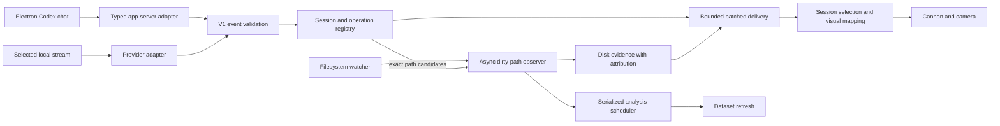

# Agent event integration

Galaxy represents work through a provider-neutral v1 event contract. Electron's
[Codex chat service](codex-chat.md) translates typed app-server events into this contract.
The workspace service can also observe an agent running outside the app through
compatibility transports: a Galaxy JSONL stream, or local Claude/Codex session records.
They do not add native chat or authentication support for another provider.



## Contract and lifecycle

An integration publishes objects with `version: 1`, a stable `id`, millisecond `timestamp`, `provider`,
`sessionId`, the canonical absolute `workspaceRoot`, `type` and `payload`. All non-session records carry
`turnId`; operations also carry `operationId`. IDs contain letters, digits, underscores, dots or hyphens,
up to 160 characters. File paths are relative to the workspace, without traversal or symlinks. Payloads
are capped at 64 KB, with at most 128 file paths or declared changes.

| Type | Required payload / behavior |
|---|---|
| `session.started` | `displayName`; registers one explicit provider/session |
| `turn.started` | `text`; unique `turnId`, one running turn per session |
| `operation.started` | `action`; optional `files`, `changes`, `tool`, `label`, `command` |
| `operation.updated` | optional measured `progress` or structured result metadata; active operation |
| `question.resolved` | `requestId`, `state`; original question turn, even after turn completion |
| `operation.finished` | `ok`; same turn/operation; optional result or error |
| `message` | `role` (`assistant`, `reasoning`, `error`) and `text` |
| `usage` | `context`, optional actual `contextLimit`; no guessed model capacity |
| `attention` | `reason`, e.g. retry or compact |
| `turn.finished` | `outcome`: `completed`, `failed`, `interrupted` |
| `session.ended` | ends the registered session |

Actions are `read`, `search`, `edit`, `create`, `delete`, `command`, `delegate`, `web`, `task`, `load`,
`question`, `other`, `artifact`, `build`, `test`, `repository`, `ui`, `transfer`, `debug`. `tool` is descriptive metadata; visual behavior is chosen from `action`. A delegated
operation can be referenced by a child's `parentOperationId`, scoped to that provider, session and turn.

The runtime rejects unknown sessions, overlapping turns, stale turn events, reused operation IDs,
duplicate outcomes, wrong workspaces and invalid paths. Re-sending the same event ID is deduplicated.
Operation outcomes inherit the semantic action and file paths of their start record. Session and
operation IDs are namespaced by provider, so identical IDs from different providers remain separate.
After a terminal turn event, further activity requires a new turn ID. Producers must stop publishing a
turn's children before finishing it; independent background work should use a separate session.

## Observing an outside agent

Electron's main process exposes observation through preload IPC (`listAgents`, `connectAgent`,
`chooseEventStream`, `waitForAgent`, `cancelWaiting`, `disconnect`, `selectSession`); the renderer
currently has no controls for it. Waiting for a new session lets an agent started outside the app,
in an empty folder, show its first prompt and operations.

Future-session discovery takes a baseline of existing log paths, then watches directory notifications.
It ignores existing logs and sessions with a different canonical workspace, claims one matching new
session, disposes the directory watcher and attaches to that file from offset zero. This explicit mode
captures the first prompt and any operations already written during attachment; it does not replay an
existing chat or keep switching to newer chats. Incomplete headers get bounded retries, and later appends
can retry them. Date directory traversal, pending metadata reads and directory watchers are bounded.
If the provider has not created its log directory yet, only its nearest existing parent is watched until
the directory appears. Idle discovery does not periodically scan directories.

Agent commands and supported operations can animate before source files exist. Disk-confirmed folders
and files form as they are created; sources in any supported language (`source-model/languages.js`) become
planets after a debounced analysis. No analyzer process starts for a folder without supported sources.
Source families are discovered as files arrive, so projects that start in any supported language, or mix them, work. Non-source
files have typed formation effects without becoming source planets. Graph and symbols are prepared in
a temporary directory before replacing the visible dataset; the view retains its camera and ongoing
formations across refreshes.
When the first sources arrive, **Follow agent** frames the new workspace to the panel's field of view.
It respects the user's camera grace period, which persists across dataset refreshes.

## Local streams and provider compatibility

Three transports can be attached: a Galaxy event stream, a Claude transcript or a Codex session. A Galaxy JSONL
stream starts with a v1 `session.started` record, followed by v1 activity records using the same identity.
Attachment reads that header and tails future records from EOF. Existing activity is not replayed.
The selected stream stays selected; a later-modified file cannot silently replace it.

The Claude option lists the workspace's transcripts once and offers an existing session or the explicit
future-session mode above. It translates
new records into v1 operations; only that transcript and its subagents are observed. It is a read-only,
best-effort compatibility transport, depending on Claude's private local record format. Work that began
before attachment can have missing start records; those unmatched results are ignored. A provider's
direct API integration supplies stronger lifecycle guarantees.

The Codex option discovers local rollout headers once under `$CODEX_HOME/sessions` (default
`~/.codex/sessions`), reading at most eight headers concurrently and at most 256 KB per header.
Only sessions whose canonical `cwd` matches the open workspace are offered. After explicit selection,
it watches that file alone from the captured EOF. The explicit future-session mode instead starts at
zero after verifying its workspace header. A bounded 256 KB tail primes recent turn context
without replaying history. If that tail has no context, activity waits for the next recorded turn context.
Future turns with a different cwd are ignored. Desktop, VS Code and CLI sessions are supported when
they persist this local rollout format; cloud-only or ephemeral sessions have no local file to attach.

Codex typed items and tool records become semantic events. `apply_patch` headers and typed file-change
manifests declare exact paths, including renames; shell command text never declares writes. Large
manifests are split into bounded operations without losing paths. Completed-item duplicates and
response/message copies are suppressed. Context usage uses input tokens once and a recorded limit
when present. Opaque code-mode wrappers are not evaluated, and encrypted reasoning is not decoded.
Codex's local rollout layout is a private compatibility format. Some typed changes are recorded only
after completion: declared paths are checked on disk and reconciled against recent evidence. Changes
outside the bounded reconciliation window, or with conflicting evidence, remain unattributed/ambiguous. Child sessions can be connected explicitly; this adapter
does not automatically tail other sessions or their files.

Streams use async 64 KB chunk reads, preserve partial lines and UTF-8 boundaries, tolerate malformed
records, handle truncation/replacement, and retain bounded metadata while skipping large media values. Directory watch
notifications trigger reads. A two-second single-file stat check recovers missed watch notifications;
it does not scan project/session directories or read unchanged file contents.

## Disk evidence and attribution

`WorkspaceObserver` takes one async filesystem baseline, primes only analyzed source files, then reads
dirty paths. Repeated notifications coalesce over 120 ms. It checks the actual filesystem before emitting
`file.changed`, `entity.created` or `entity.deleted`; unchanged saves do not emit changes. New parents are
reported before their child, and repeated notifications cannot replay a creation. Dependencies, build
output, environment secrets and symlinks are excluded. Oversized or uncached text has unknown line counts.

An `edit`, `create` or `delete` operation declares exact `files`. A `command` must explicitly declare
`changes: [{path, change}]` to be a write-attribution candidate; filenames found in command text do not
prove a write. The observer captures candidate attribution when a notification arrives and retains
successful candidates for five seconds to allow late filesystem notifications.

| Attribution | Behavior |
|---|---|
| `correlated` | Exactly one candidate; the selected session may aim/fire at that disk change |
| `ambiguous` | Multiple candidates; labeled Workspace change, no attributed shell |
| `unattributed` | No candidate; labeled Workspace change, no attributed shell |

Disk evidence proves the file changed. Correlation cannot prove which process wrote it: a manual save
to the exact same file during an agent operation may still correlate. This limitation is represented
explicitly, rather than claiming every save during a busy turn came from the agent. Directory-only
notifications without a matching declared path remain unattributed.

## Performance and execution boundaries

- No global Claude process polling or automatic latest-session discovery.
- The renderer's animation delivery has a 1,024-event queue and processes at most 32 records per
  animation frame; overflow skips visuals, never history.
- The runtime caps registrations at 32 sessions, outstanding/recent operations at 512, and deduplication
  at 8,192 event IDs. Read-only operation state expires immediately after completion.
  A session also retains the most recent 256 turn IDs and up to 4,096 used operation IDs in its current
  turn, preventing reuse after a completed read has left the attribution index.
- Source text caching is capped at 32 MB and 2 MB per file. The dirty-path queue caps at 4,096 paths;
  overflow reports a warning and schedules analysis. The baseline path index scales with workspace size.
- Native analysis debounces 650 ms, has one active run, and schedules one trailing run if new changes
  arrive during analysis. Parsing remains a **full repository analysis in a child process**; this change
  does not implement incremental AST analysis.
- Journals batch asynchronous writes over 32 ms and flush before history reads and shutdown. History
  snapshots read a bounded tail (8 MiB / 4096 events); the Activity inspector paginates that retained view.
- Slow project streams reconnect from persisted history when their socket backlog exceeds 256 KB.
  Historical activity stays readable and is not replayed as animation.

## Verification

`node checks/agent-runtime.cjs` covers path attribution, ambiguity, duplicates, stale events, stream
recovery and disposal. Its deterministic burst produces one disk read and one change for 500
notifications of the same file. Two bursts of 100 analysis requests produce two sequential runs with
maximum concurrency one. These are fixture counts, not a throughput benchmark on a large workspace.
`node checks/codex-integration.cjs` covers the Codex rollout decoder and observed-session connections.
No check calls a model.

# Reliable ingestion, evidence, and structured jobs

The v1 contract now also accepts `operation.updated` and `question.resolved`, and the actions
`artifact`, `build`, `test`, `repository`, `ui`, `transfer`, and `debug`, through the same
runtime, observer, resource normalization and visual mapper. Existing providers remain valid.

`engine/agent/resources.cjs` converts file URLs before resolving paths. Workspace files have `{path}`;
external files and web references have `{uri}` and never masquerade as workspace nodes.
The incremental `JSONLDecoder` projects records in 64 KiB input chunks, caps retained strings,
nodes and nesting, and omits embedded media. Large records retain their operation identity and
outcome. `_projection.truncated` / `metadataTruncated` explicitly identify shortened metadata.
Unknown typed tools produce `other` operations with `unsupported: true`.

The observer tracks non-source content as well as code. Small text uses the existing bounded
text cache; large/binary files use size/mtime/ctime evidence, not fabricated line counts or
content hashes. Only supported source changes schedule code analysis. A 10-second / 4096-event
journal reconciles late exact-path manifests with disk evidence. Corrections reference the
original event via `evidence.updated`; the viewer updates attribution without replaying a shot
or creation. Multiple distinct candidate changes remain ambiguous. This is bounded correlation,
not proof of causality for arbitrary shell scripts or changes outside the observation window.

## Publishing structured jobs

Publish through the canonical event-stream connection or `WorkspaceService.publish`.
`engine/agent/jobs.cjs` supplies a lifecycle helper for instrumented tools:

```js
const job = startJob(emitter, {
  action: 'artifact', artifactType: 'model', label: 'Export shuttle',
  inputs: [{ path: 'models/shuttle.blend' }],
  changes: [{ path: 'assets/shuttle.glb', change: 'create' }]
});
job.update({ progress: { completed: 2, total: 3 } }); // only measured progress
job.finish(true, { outputs: [{ path: 'assets/shuttle.glb' }] });
```

Adapters may translate explicit tool metadata (`galaxy`) through `engine/agent/semantics.cjs`.
Tests can report `tests: {passed, failed, skipped, total}`; repository jobs can report
`revision`, `branch`, `remote`, and `pushConfirmed`. A shell command mentioning a test runner
or Git does not establish those results. The Codex adapter recognizes image-generation records,
including their saved output resource, and marks browser tool activity as `ui`. Nested browser
code is never executed or parsed into supposed clicks. Existing completion-only logs carry
`completionOnly` and recorded timing where available, rather than fictional live progress.

Artifacts/builds drive up to four lazy, cached factory/ship rigs. Declared successful outputs
appear as artifact parcels; actual workspace creation still requires disk evidence. Transfer
and debug ships require explicit `{from, to}` resource endpoints. Click a ship to follow it;
it stays at its destination, manual navigation takes precedence, and rebuilds carry its state.
An ordinary test command does not invent a trace. Extra simultaneous jobs remain in Activity
when visual capacity is occupied.

An asynchronous question finishes its tool call with `awaitingAnswer: true` and `requestId`.
Its beacon persists across a completed turn until `question.resolved` supplies that request ID
and `state: 'answered' | 'cancelled'` (with the original turn ID). Multi-part Codex answers are
joined by request ID. Compaction's duplicate typed/raw representations are suppressed.

## History and verification

The Activity button exposes searchable, paginated canonical events, including outcomes, resources,
timing and attribution revisions. History is recorded before animation batching. Each project's
history is `activity.jsonl` in its project data directory, with a 32 MiB current and previous
segment, an 8 MiB / 4096-row memory bound, a bounded startup tail, and explicit write-pressure errors.
Snapshots read at most the latest 8 MiB / 4096 events, while visual history and queues are
separately bounded. Retention is not unlimited.

Offline checks (no model requests):

```sh
node checks/agent-pipeline.cjs
node checks/agent-runtime.cjs
node checks/codex-integration.cjs
node checks/rigged-assets.mjs
```
